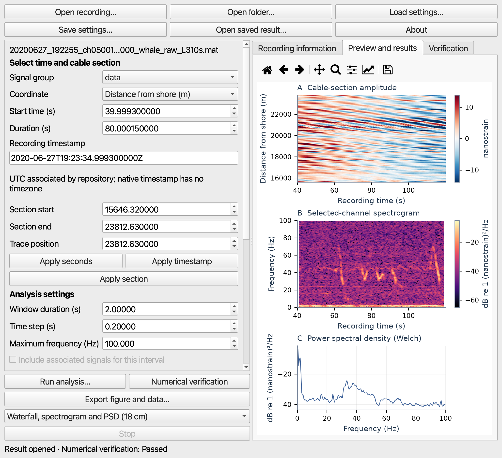

# DAS Workbench

A desktop graphical interface for reproducible analysis of marine distributed acoustic sensing recordings.

DAS Workbench connects recording inspection, time and cable-section selection, waveforms, spectrograms, power spectral densities, spatial RMS summaries, numerical verification, and figure export. It works on local files and preserves the distinction between native DAS measurements and calibrated acoustic pressure.

**Version: 0.3.4.post1.** This packaging update retains the scientific algorithms and saved-result contracts of v0.3.4. It adds the illustrated guide and dependency notices, removes an unused Qt virtual-keyboard component, and updates version/About text. The application is research software; its validation scope is documented below.

## Start here

1. Download the macOS arm64 application ZIP from the [Releases page](https://github.com/shashidhar1801/DAS-Workbench/releases) and verify its SHA256 against `SHA256SUMS.txt` in the same release.
2. Extract the ZIP, copy **DAS Workbench.app** to a writable Applications folder, and launch it. The build is ad-hoc signed, not Apple notarized. See [Installation](docs/INSTALLATION.md) for the supported installation route and limitations.
3. Choose **Recording analysis…** for the four public event examples, or stay in **Local phase analysis** for compatible OOI OptaSense files.
4. Follow the [illustrated user guide](docs/USER_GUIDE.md). Download the PDF guide from Releases for an offline copy.

You can begin without a large recording download: **Synthetic demo** exercises the phase workspace, and the separate example-bundle release asset can be reopened through **Open saved result…**. Reanalysis and fresh source-based numerical verification require the matching original recording.

*Actual author-run v0.3.3 packaged-GUI capture using the Svalbard manuscript example. These controls and numerical definitions are retained in v0.3.4.post1. See the [screenshot record](docs/SCREENSHOT_PROVENANCE.json) for capture origins; this image is not a new independent user study.*

## Documentation

- [Illustrated guide and manuscript tutorials](docs/USER_GUIDE.md)
- [Exact example files, citations and recipes](examples/README.md)
- [Scientific definitions and interpretation limits](docs/SCIENTIFIC_SCOPE.md)
- [Installation, source execution and rebuilding](docs/INSTALLATION.md)
- [Validation scope and release checks](docs/VALIDATION.md)
- [Dependency licences and source access](THIRD_PARTY_NOTICES.md)
- [Release history](CHANGELOG.md)

## Supported workflows

| Workspace | Evaluated inputs | Computation |
|---|---|---|
| Recording analysis | Selected Svalbard MAT v5, Mediterranean and Trondheimsfjord ASN HDF5, Lake Zurich three-stream HDF5 | CPU float64; quantity-aware native analysis and independent numerical verification |
| Local phase analysis | Compatible OOI OptaSense processed-phase HDF5; 200 and 1000 Hz examples | CPU float64; optional Apple MLX FFT with CPU comparison and fallback; streaming overview; spectral checkpoint/resume |

Recognition is based on supported schemas and metadata, not simply a `.h5`, `.hdf5` or `.mat` extension. Arbitrary vendor formats are not guaranteed to work. Native recording folders are a bounded file picker, not a continuous multi-file merger. OOI collections are indexed into compatible continuous runs.

The evaluated desktop platform is Apple Silicon macOS. Windows, Intel Mac, Linux desktop packaging, NVIDIA execution and independent clean-machine installation have not been established by this release. Backend availability is checked at runtime. GPU selection does not promise a speedup or measured full GPU occupancy.

## Reproducibility and data

Export folders retain numerical products, settings, source identity, scoped validation sidecars and PNG/PDF/SVG figures. Keep the whole folder together. Complete saved analysis products are retained without display clipping; original recordings remain necessary for reanalysis. Display-reduced waterfall data are not a replacement for the full original waveform array.

The manuscript examples include source-associated whale and ship recordings and a controlled freshwater playback. Numerical agreement does not independently establish source identity, pressure calibration, clock synchronization or ecological interpretation. The [scientific scope](docs/SCIENTIFIC_SCOPE.md) records the unresolved metadata findings.

Raw recordings are obtained from their original providers and are not bundled in the application or Git repository. The example export asset contains derived products under their source-data attribution terms. The terabyte-scale OOI collections and historical build/evidence directories are not part of the source download.

## Licence and citation

The application code and original documentation are released under the [MIT licence](LICENSE). Bundled dependencies retain their own licences, including LGPL terms for the Qt/PySide components. Dataset-derived examples and plots retain the source-data terms and attribution described in [examples/README.md](examples/README.md).

Please cite the software using [CITATION.cff](CITATION.cff), give the version, and cite the original dataset for each recording you use. No archival DOI is claimed.

Maintainer: **Shashidhar Siddagangaiah**, Department of Systems Engineering and Naval Architecture, National Taiwan Ocean University, Keelung, Taiwan. [ORCID](https://orcid.org/0000-0001-7248-6538). Contact: shashi.18j@gmail.com.

For problems, open an issue with the version, platform, input schema, exact selection/settings and a diagnostic report. Do not post private recordings, credentials or private filesystem paths. See [CONTRIBUTING.md](CONTRIBUTING.md).
