# DAS Workbench User Guide

**Version 0.3.4.post1 · Manuscript examples · 31 October 2026**

This guide takes you from a local recording to a saved, numerically checked figure bundle. It uses the Svalbard, Mediterranean, Lake Zurich, Trondheimsfjord and OOI examples evaluated in the manuscript. No processing scripts are required for the graphical workflows.

**Begin with the correct workspace.** The entry window is **Local phase analysis**, for compatible OOI OptaSense recordings. Choose **Recording analysis…** in its toolbar for the four native public-event files. These are distinct workflows with different input profiles, controls and stopping behavior.

**What you need.** An Apple Silicon Mac, the application ZIP, a writable results folder, and the selected original recording for reanalysis. A saved example bundle is enough to inspect previously calculated results. Original recordings are not included in the source or application download. The exact filenames, public source links and fingerprints are in `examples/README.md` and `examples/recordings.json`.

1. Download and verify the application ZIP against the release SHA256 manifest. Extract it and copy the app to Applications. The package is ad-hoc signed and not notarized; review macOS's trust prompt yourself. See `docs/INSTALLATION.md` for details and the source-build alternative.
2. For a quick first look, choose **Synthetic demo** in the phase workspace, or **Recording analysis… → Open saved result…** and select one of the separate example-bundle folders.
3. For a new analysis, follow **open → inspect → select → review settings → run → numerical verification → export → reopen**.

**Guide map.** Sections 1–3 explain the native workflow. Sections 4–9 reproduce the four manuscript cases and the window comparison. Sections 10–12 cover OOI indexing, spectra and full-fibre overviews. Sections 13–15 explain saved files, stopping, troubleshooting and citation.

**Screenshots.** These are genuine historical author-run packaged-GUI captures, not mockups. Native case captures are from v0.3.3; OOI captures are from the v0.3.4 timing edition, with one clearly identified v0.2.1 overview. Their controls and algorithms were checked against this release source. Capture versions and hashes are in `docs/SCREENSHOT_PROVENANCE.json`. They do not constitute fresh independent user testing or new benchmark runs.

<!-- PAGE -->

## 1 Open and inspect a native recording

1. From the entry window, click **Recording analysis…**, then **Open recording…**. Select the exact `.mat`, `.h5` or `.hdf5` file. The first source-identity check may take time for a large file.
2. Read **Recording information → Summary** before analysis. Check the signal group, sample rate, sample/channel counts, unit, coordinate origin and clock qualification. **Detailed metadata** retains source declarations and unresolved findings.
3. Select the intended **Signal group** and **Coordinate**. A channel index, distance along fibre and distance from shore are different coordinates.

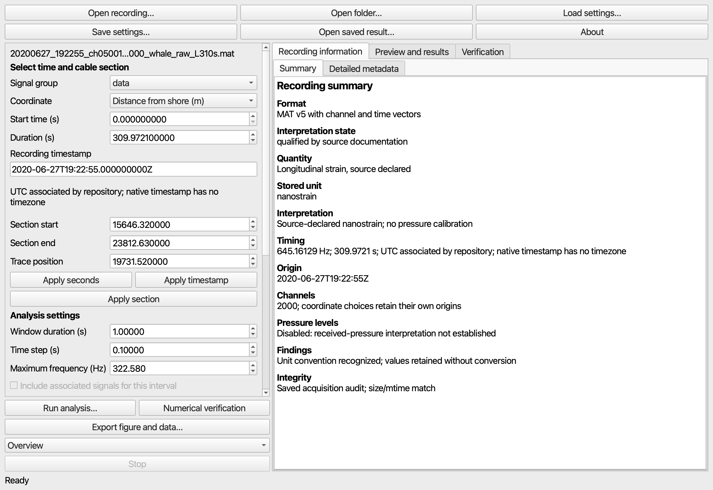

*Svalbard metadata in the packaged native workspace. Use the source-declared nanostrain and the explicitly named shore-distance vector. The timestamp's UTC association comes from repository documentation.*

**Open folder…** lists supported candidates and lets you choose one file. It accepts at most 100 candidates and does not merge a native event collection. Use the phase workspace for the evaluated multi-file OOI runs.

<!-- PAGE -->

## 2 Select time and cable section

For exact manuscript reproduction, open the recording and click **Load settings…**, then select the corresponding JSON in `examples/recipes/`. This restores samples, channels, trace, coordinate, windows and display settings. Changing a reviewed selection can correctly change its event interpretation to **unreviewed selection**.

For your own selection, enter **Start time (s)** and **Duration (s)**, then click **Apply seconds**. Alternatively enter a native-clock ISO timestamp and click **Apply timestamp**. Set **Section start**, **Section end** and **Trace position**, then **Apply section**. Check the accepted samples under **Advanced settings**.

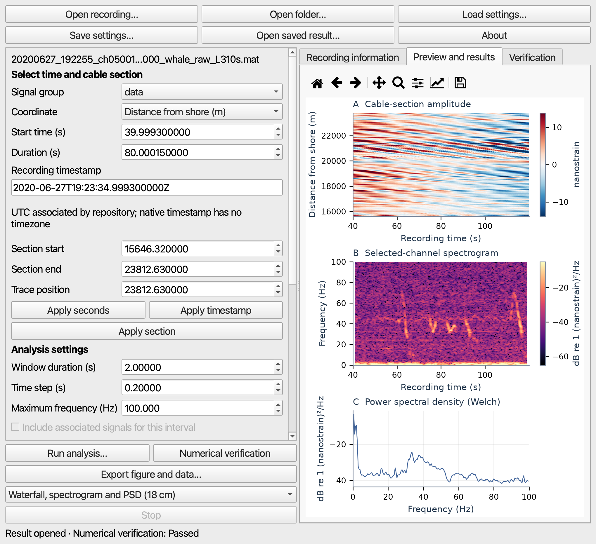

*Svalbard manuscript selection: 39.9993 s start, 80.00015 s duration, 15,646.32–23,812.63 m from shore, and trace index 1999. Full values are in the supplied recipe.*

**Index rules.** Samples and array channels are zero based. `0:2000` includes 0–1999. Start sample is inclusive; end sample is exclusive. Coordinate bounds are inclusive. Do not type a physical distance into an array-index field.

<!-- PAGE -->

## 3 Plan run and verify

1. Set **Window duration (s)**, **Time step (s)** and **Maximum frequency (Hz)**. **Advanced settings** exposes FFT samples, waterfall sample bin, channel stride and received-level windows.
2. Click **Review analysis settings**. Read actual rounded sample counts, frequency spacing, estimated storage and any blocking reason. **Use suggested display bin** explicitly accepts a display reduction; it does not change the native waveform/RMS calculation.
3. Click **Run analysis…** and give a new result-folder name. Wait for completion. A result first appears without fresh numerical verification.
4. With the matching source still open, click **Numerical verification**. Read the **Verification** tab and **Show verification details**. If verification fails, inspect the stated mismatch before publishing.

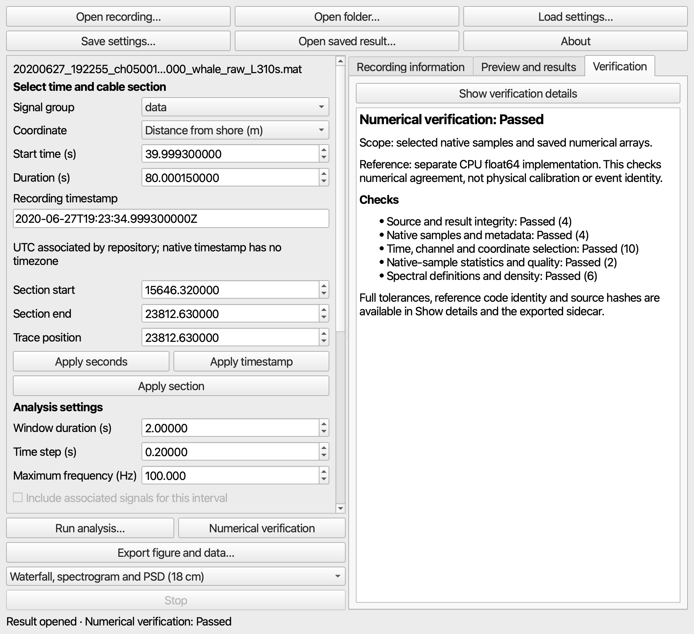

*A Passed sidecar reports numerical agreement for the bound saved products and reference scope. It does not validate whale species, physical calibration or external clock synchronization.*

**Preview** reads only a bounded initial part of the selected trace. It is useful for checking readability; it is not the completed full-selection analysis.

<!-- PAGE -->

## 4 Reproduce the Svalbard example

Open `20200627_192255_ch05001_to_ch07000_whale_raw_L310s.mat` from Zenodo 5823343. Load `svalbard.json`.

- Signal: `data`; coordinate: **Distance from shore (m)**.
- Samples: `[25806,77419)`; channels: `0:2000`; trace: `1999`.
- Requested Hann window: 2 s; step: 0.2 s; display maximum: 100 Hz.
- Accepted window: 1290 samples (1.9995 s); hop: 129 samples (0.19995 s).
- Waterfall: bin 10 and stride 10. These reduce the displayed waterfall only.

Run and verify as in Section 3. To obtain the main spatial/spectral presentation, select **Waterfall, spectrogram and PSD (18 cm)**. For waveform and RMS context, choose **Overview**. Export each to a separate new folder, then reopen it.

The transient spectral structures should be visible around 30–50 Hz in the chosen interval. Slower unfiltered variations contribute strongly to waveform amplitude. A dominant Welch peak and the selection-wide RMS describe different aspects of the trace.

**Coordinate limit.** This block ends at 23.81263 km from shore. It does not contain the published 25.1 km shore apex. The other native position vector must not be substituted to make the apex fit. No companion file or additional download is required for this recipe.

**Interpretation.** Retain the source-associated whale label; do not infer a locally confirmed species or pressure level. The figure units remain source-declared nanostrain. The screenshot in Section 2 shows this exact case selection.

<!-- PAGE -->

## 5 Reproduce the Mediterranean example

Open `091304.hdf5` from the `DAS_MedSea/data` folder in Zenodo 15008561. Load `mediterranean.json`.

1. Confirm `/data`, samples `[0,727)`, channels `748:13000` and trace `8663`.
2. Use a 1 s window, 0.1 s step, 35 Hz display maximum, waterfall bin 1 and stride 16. The accepted window is 73 samples (1.00375 s), hop 7 samples (0.09625 s).
3. Run, verify, select **Spectrogram, waveform and PSD (18 cm)**, export, and reopen.

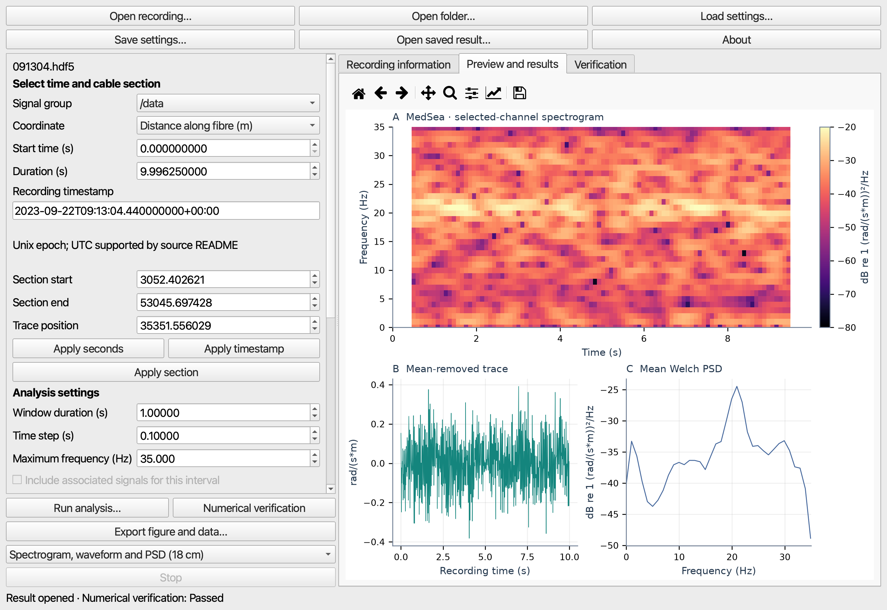

*The approximately 20 Hz concentration appears in the selected trace. This screenshot shows the complete 9.99625 s manuscript selection. Bin 1 means no temporal averaging in its waterfall.*

The quantity is phase rate per distance, rad/(s m). Header and documentation gauge values remain inconsistent; the app does not silently convert this recording to strain or pressure.

<!-- PAGE -->

## 6 Compare spectral windows

Keep the same Mediterranean recording open and load `mediterranean_window_comparison.json`. The **Compare with a 4 s window** option is enabled. The source samples, trace, units and colour reference are shared by both calculations.

1. Review the plan. The first window is 73 samples; the second is 291 samples (4.00125 s). Both use a 7-sample hop.
2. Run into a new folder, verify, then select **Window comparison (18 cm)**.
3. Export and reopen the comparison folder. Confirm both panels show the same native selection and that their window lengths are labelled.

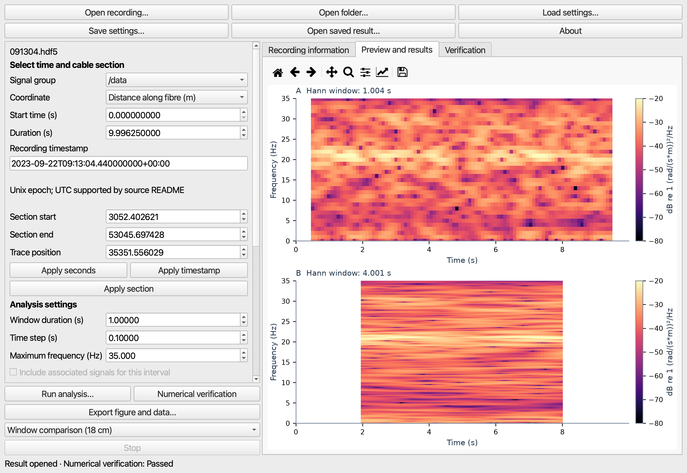

*Longer windows provide finer frequency-bin spacing and more temporal smoothing. The approximately 20 Hz feature persists. A smaller hop gives more overlapping estimates; it does not undo the temporal averaging intrinsic to a longer window.*

Changing FFT samples alone adds interpolation when zero padding is used. It should not be presented as equivalent to a longer observed window or improved physical resolving power.

<!-- PAGE -->

## 7 Align the Lake Zurich signals

Open `2022-01-26--04-46-16--Humpback.h5` from Zenodo 7886409. Load `lake_zurich.json`.

1. Confirm primary group `/DAS`, coordinate **Channel index**, samples `[50,150050)`, channels `0:946` and trace `820`.
2. Confirm **Include associated signals for this interval** is checked. The common start is `2022-01-26T04:46:24.611960Z` and the duration is 30 s.
3. Use 0.1 s windows, 0.05 s step and 2500 Hz display maximum. Review the plan for all three streams, then run and verify.

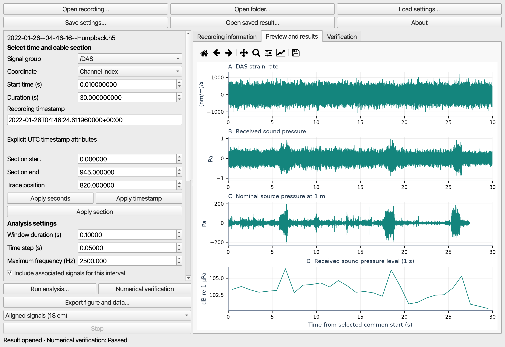

*The compact **Aligned signals (18 cm)** presentation shows three waveforms and received levels. It is a four-panel alternative to the eight-panel Overview used for the manuscript's fuller comparison.*

DAS stays at 5 kHz; received and nominal-source pressure stay at 50 kHz. Alignment uses recorded timestamps without resampling. Sample 50 excludes the extreme initial DAS sample by an explicit time selection.

<!-- PAGE -->

## 8 Export the Lake Zurich eight panel overview

After the aligned analysis finishes, choose **Overview** in the presentation selector, then **Export figure and data…**. This layout contains the DAS, received-pressure and nominal-source waveforms and spectrograms, received-pressure Welch PSD, and received levels. Reopen the exported folder.

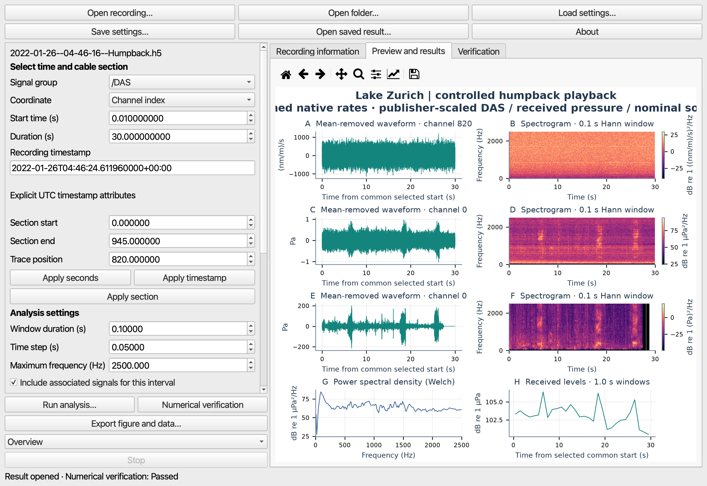

*Historical GUI preview of the manuscript's eight-panel content. The narrow preview can clip a long title; export is rendered from the saved full figure, independently of the temporary viewport. Enlarge the window or move the splitter when inspecting it.*

**Read the quantities separately.** DAS is publisher-scaled strain rate, not pressure. `/Recorder-C` is received pressure. `/Source` is nominal pressure at 1 m, not another receiver. Their spectral dB colour scales have different references.

The 1 s received levels use the native pressure bandwidth, not the 0–2500 Hz plot limit. This is controlled freshwater playback, with publisher-provided calibration; it does not independently establish a DAS pressure response or propagation delay.

<!-- PAGE -->

## 9 Reproduce the Trondheimsfjord example

Open `Trondheim_DAS_Data/085437.hdf5` from Zenodo 18851481. Load `trondheim.json`.

1. Confirm samples `[0,5682)`, channels `64:10500`, trace `500`, and **Distance along fibre (m)**.
2. Use a 0.5 s window, 0.05 s step and 250 Hz maximum. Accepted values are 284 samples (about 0.499818 s) and a 28-sample hop. Waterfall bin is 5; stride is 16.
3. Run, verify and export **Spectrogram, waveform and PSD (18 cm)**. **Overview** adds spatial amplitude and RMS context.

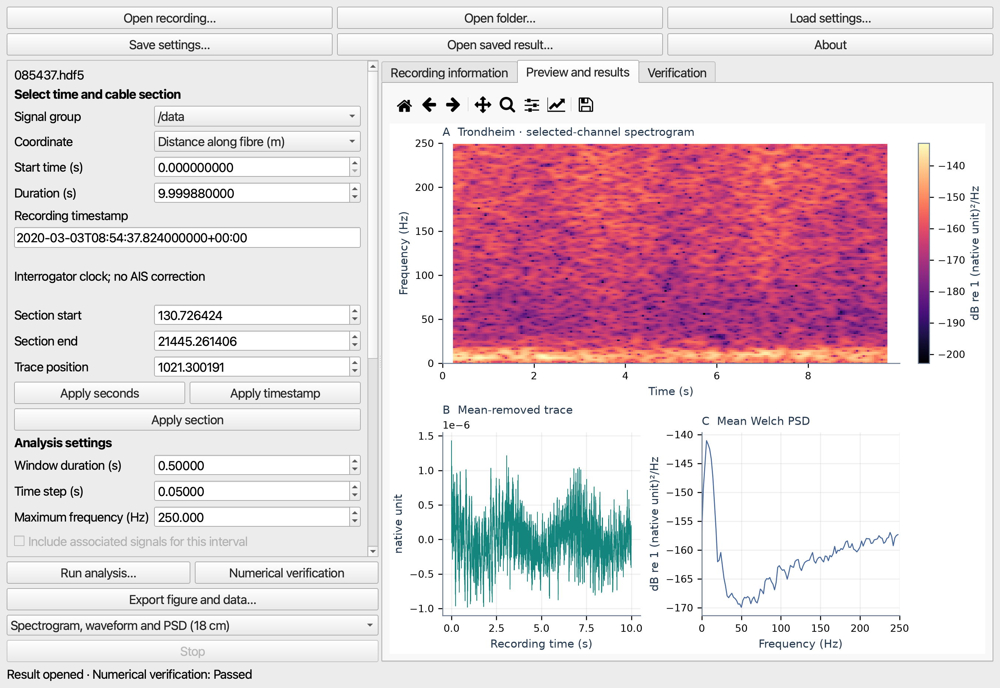

*The approximately 10 s source-associated ship window retains native amplitude. The first 64 channels are excluded explicitly, not filtered or masked.*

Quantity declarations conflict, so no calibrated strain-rate or pressure interpretation is asserted. The displayed timestamp is the interrogator clock; no AIS offset or vessel identity has been inferred. This short interval does not establish a full ship passage.

<!-- PAGE -->

## 10 Open OOI files and continuous runs

Return to the **Local phase analysis** entry window. Choose **New / open project** and use a new writable project folder. Click **Open file** for one compatible OOI recording, or **Add folder** for a collection. Select the acquisition/run in **RECORDINGS / CONTINUOUS RUNS**.

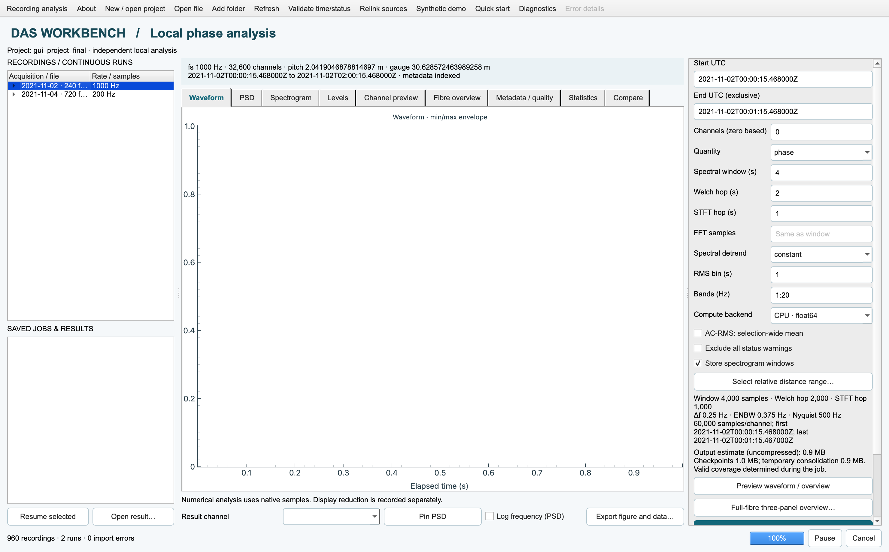

*Historical catalogue of the 960-file evaluation: 720 files at 200 Hz and 240 at 1000 Hz. A tutorial can start with just one file; this screenshot does not imply those collections are included in the download.*

Read **Metadata / quality** and use **Validate time/status** when examining continuity and status coverage. Header sampling rate is authoritative; the pulse-rate text in a filename is not necessarily the stored sampling rate.

For the 200 Hz first file, use UTC start `2021-11-04T00:00:02.025000Z` and exclusive end `2021-11-04T00:01:02.025000Z`. For the 1000 Hz first file, use `2021-11-02T00:00:15.468000Z` to `2021-11-02T00:00:45.468000Z`. These are 60 s and 30 s intervals respectively.

<!-- PAGE -->

## 11 Calculate OOI spectra and choose a backend

Start with channels `10200:10220` and the one-file interval in Section 10. Choose **phase**, a 4 s spectral window, 1 s Welch hop, 1 s STFT hop, constant detrending, 1 s RMS bins, and bands `1:20,20:90`. Leave FFT samples at the window length: 800 at 200 Hz or 4000 at 1000 Hz. Enable **Store spectrogram windows**. For selection-wide AC-RMS, enable its checkbox explicitly.

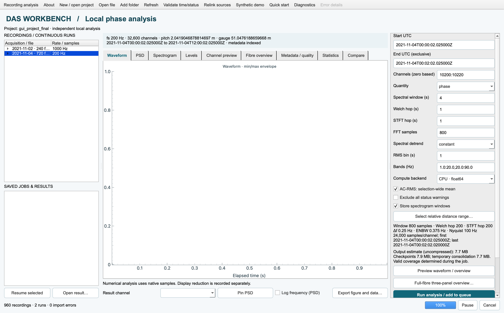

*The historical screenshot uses a 120 s selection. Use the shorter one-file bounds above for your first run. Read the output/checkpoint estimate before clicking **Run analysis / add to queue**.*

Use **CPU · float64** first. Then, if available, repeat with **Apple GPU · CPU audited** in a new job. This path checks GPU FFT results against CPU and can fall back; it does not guarantee a speedup. File reading, conversion, reference checks and output writing can dominate elapsed time. Full-core GPU occupancy was not measured by these screenshots.

After completion, select a **Result channel**, inspect **PSD** and **Spectrogram**, and export. Keep frequency linear for the manuscript examples; **Log frequency (PSD)** changes the PSD display only.

<!-- PAGE -->

## 12 Generate a full fibre overview

Select an OOI run and its UTC interval. Click **Full-fibre three-panel overview…** or open **Fibre overview → Generate full-fibre overview…**. The overview always uses all fibre channels, independently of the spectral channel selection.

1. Choose trace index `14692` for the approximately 30 km trace in the example. Set waterfall channel stride 16 and sample bin 10 for a short demonstration. Bin 1 requests no temporal display averaging and may require a shorter interval.
2. Read the explicit plan. If a larger display bin is proposed, either accept it using the provided button or shorten the selection. Do not describe a reduced waterfall as a full-resolution matrix.
3. Generate, inspect the three panels, and use **Export three-panel figure…**. Reopen the result folder using **Open result…**.

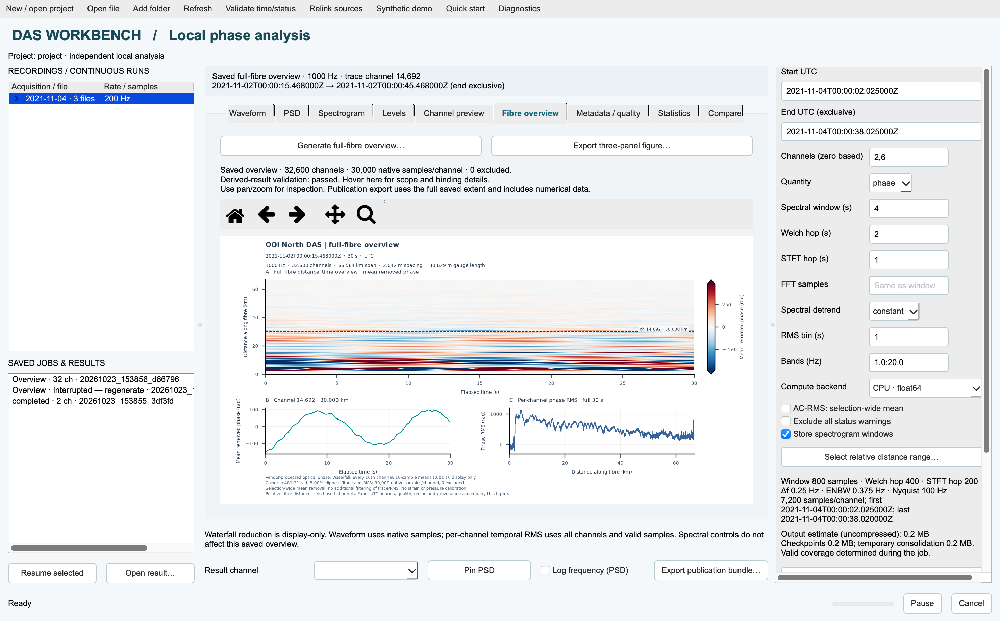

*Historical v0.2.1 capture of a saved 1000 Hz, 30 s overview. The saved-result banner identifies its actual interval. The editable controls at right concern a different current selection and do not redefine the reopened result. Later releases retain these overview definitions.*

The native trace and all-channel RMS use the full selected valid samples. Only the waterfall is display-reduced. Distance is along-fibre relative distance, not a map coordinate. Counts-to-radians scaling is not a conversion to pressure or strain.

<!-- PAGE -->

## 13 Export reopen and preserve the evidence

For native cases, choose the intended presentation, click **Export figure and data…**, and supply a new folder name. The compact 18 cm layouts and the Overview layout share the saved numerical products but display different panels. For OOI spectra use **Export figure and data…**; for OOI overviews use **Export three-panel figure…**.

1. Open the exported PNG or PDF and check all labels, units, time/distance axes and colour references. Zoom/pan in the GUI is temporary; export uses the saved selection.
2. Keep the whole bundle together. Native bundles include `numeric.h5`, recipe, manifest, presentation settings, figure PNG/PDF/SVG, statistics, captions, checksums and any bound validation report. OOI bundles use their corresponding phase/overview formats.
3. Reopen native folders through **Open saved result…**. Reopen OOI result/overview folders through **Open result…** in the phase workspace. Confirm the saved-result identity and validation scope, rather than relying on currently editable controls.
4. Retain the original recording and its source citation for reanalysis. The complete saved analysis products are retained without display clipping; the bundle does not substitute for all raw/native recording samples.

**Caption checklist.** State the source, measurement quantity, coordinate origin, selected interval/channels, trace, window and hop, detrending, one-sided density reference, display reductions, verification scope and unresolved interpretation limits. Processing captions are a starting point and still need an article-specific narrative.

**Extending to full OOI collections.** Add the two 200 Hz folders to the same project and verify continuity before selecting their combined 12 h run. The 1000 Hz folder forms a separate 2 h run. Full-duration overviews and 20-channel spectra are different jobs. A successful full-fibre overview does not establish that a dense all-channel, full-duration spectrogram was computed.

<!-- PAGE -->

## 14 Stop pause and solve common problems

**Native recording Stop.** Clicking **Stop** acknowledges the request and waits for bounded in-flight work. The interrupted analysis must be regenerated. Wait for the stopped state before starting another operation.

**OOI overview Stop.** Overview jobs also require regeneration after interruption. There is no resumable full-fibre overview checkpoint contract.

**OOI spectral Pause.** Use **Pause**, wait for acknowledgement, then select the saved job and **Resume selected**. Source/settings identity and checkpoints are checked. Resume is not a way to change the recipe of an unfinished job.

**Unsupported file.** Verify the profile and workspace. A valid HDF5 container does not establish a compatible DAS schema. Choose a supported sample or report the metadata without inventing a unit conversion.

**Missing file or moved drive.** Remount the drive and use the phase workspace's **Relink sources**, or reopen the matching native file. Reanalysis and fresh verification need the original source; saved figures can be inspected from a complete bundle.

**No Passed status.** A new result has not yet been independently checked. Run **Numerical verification** for native results. If it reports failure or an identity mismatch, read the check details and regenerate from the matching source/settings. Do not edit the sidecar to change its status.

**Planner blocks a job.** Reduce the time span or selected channels, or explicitly accept the suggested display bin where offered. A display bin does not reduce all native computation or disk reading. Keep free disk space for outputs and spectral checkpoints.

**Error details.** Read the concise status first, then open **Error details** and **Save diagnostic report…** if needed. Diagnostics can include private paths; review them before sharing. A completed recovery does not erase the last diagnostic automatically.

<!-- PAGE -->

## 15 Citation support and scope

**Application.** Shashidhar Siddagangaiah, DAS Workbench, version 0.3.4.post1. Department of Systems Engineering and Naval Architecture, National Taiwan Ocean University, Keelung, Taiwan. ORCID: https://orcid.org/0000-0001-7248-6538. Contact: shashi.18j@gmail.com. Use the release's `CITATION.cff`; no archival DOI has been assigned.

**Source recordings.** Cite the original creators and record used in your work:

- Bouffaut and Taweesintananon. DAS4Whale. https://doi.org/10.5281/zenodo.5823343
- Bouffaut, Goestchel, Sladen, Hartog and Klinck. Fin-whale labelled dataset. https://doi.org/10.5281/zenodo.15008561
- Rychen, Paitz, Edme, Smolinski, Brackenhoff and Fichtner. Underwater sound playback experiments. https://doi.org/10.5281/zenodo.7886409
- Thiem, Vaupel, Wienecke, Eidsvik, Taweesintananon and Landrø. Ship-tracking dataset. https://doi.org/10.5281/zenodo.18851481
- Ocean Observatories Initiative DAS experiment and its data-use policy: https://oceanobservatories.org/pi-instrument/rapid/

The four Zenodo example datasets and their derived plots retain CC BY 4.0 attribution. Application code and original guide prose are MIT licensed. Dependency notices, including Qt/PySide terms and source access, accompany the release.

**What has been evaluated.** Author-run packaged workflows and independent numerical references support the documented cases. The public packaging update passes the source regression suite and packaged maintenance checks. These are not independent participant tests or a clean-machine installation study. Windows/NVIDIA, broader vendor coverage, physical calibration and automated source classification remain outside the demonstrated scope.

The manuscript's CPU/GPU performance figure summarizes separate measured benchmark records. The GUI provides the underlying analysis workflows; this guide does not claim that its multi-trial benchmark chart is itself a native GUI export. No new speed or GPU utilization result is inferred from tutorial screenshots.

For full definitions, consult `docs/SCIENTIFIC_SCOPE.md`; for exact recipes and data fingerprints, consult `examples/`; for release checks and gates, consult `docs/VALIDATION.md`.
